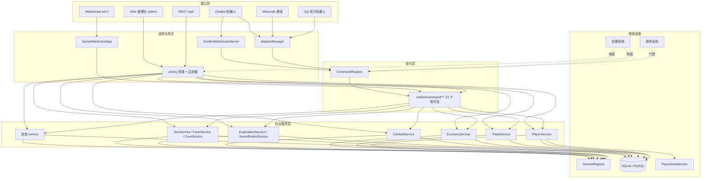

# 架构总览

## 一句话概括

一个**单进程**的 Java 服务端：所有入口（QQ 指令、REST、WebSocket、Minecraft 通道、Web 管理台）
最终都调用 `game.service` 下同一批服务类，**玩法逻辑只有一份**。



## 启动流程

入口是 `com.mtxgdn.Main`，`doMain(args)` 按固定顺序装配。**顺序不能随意调整**，
因为后面的步骤依赖前面的产物。

| # | 步骤 | 说明 |
| --- | --- | --- |
| 1 | 解析启动参数 | `--demo`（演示模式）、`--nogui`（无交互） |
| 2 | 初始化 JWT 密钥 | `JwtUtil.init(installMode)`；未安装时用临时密钥，密钥无效则 `System.exit(1)` |
| 3 | 初始化数据库 | `initializeDatabase()`：建表 → 建索引 → 迁移 → 初始化权限数据 |
| 4 | 写入默认数据 | 默认技能 `SkillService.insertDefaultSkills()`、默认功法 `TechniqueService.insertDefaultTechniques()`、默认配方 `CraftingService.insertDefaultRecipes()` |
| 5 | 扫描注册物品 | `ItemScanner.scanAndRegister()` |
| 6 | 修复装备数据一致性 | `EquipmentFixService.fixEquipmentData()` |
| 7 | 扫描注册秘境 | `SecretRealmScanner.scanAndRegister()` |
| 8 | 扫描注册游历事件 | `ExplorationEventScanner.scanAndRegister()` |
| 9 | 扫描注册指令 | `CommandScanner.scanAndRegister("com.mtxgdn.onebot.command")` |
| 10 | 初始化插件系统 | `PluginManager.init(new File("plugins"))` 然后 `loadPlugins()` |
| 11 | 初始化内置玩法模块 | `BuiltInPluginRegistry.registerAll(PluginCatalog.createAll())` → `init()` → `enableAll(ctx)` |
| 12 | 启动 HTTP 服务 | Grizzly 绑定 `http://<server.host>:<server.port>/api/`，扫描 `com.mtxgdn.rest` |
| 13 | 插件 Web 管理与启用 | `PluginWebManager.init(server, config)` → `pm.enablePlugins()` |
| 14 | 配置 Grizzly | `ServerConfigurator.configure(server)`（线程池等） |
| 15 | 注册 WebSocket | `GameWebSocketApp` 注册到 `/`，与 HTTP **共用端口** |
| 16 | 注册季节广播监听 | 季节更替时向所有 WS 客户端广播 |
| 17 | 挂载静态资源 | `/admin` → 管理台，`/install` → 安装向导（仅未安装时） |
| 18 | 启动适配器 | `AdapterManager.startAll()`（读 `config/adapters.json`） |
| 19 | 启动清理调度 | 每 5 分钟清理限流窗口与 Token 黑名单 |
| 20 | 触发 SERVER_READY 事件 | 插件可在 `onEnable` 注册监听器 |
| 21 | 启动 MOTD 服务器 | `MinecraftMotdServer`（默认端口 25565） |
| 22 | 进入运行模式 | `--demo` → 演示；`--nogui` → 无交互；否则交互控制台 |

::: tip 扫描注册是关键模式
物品、秘境、游历事件、指令这四类东西都不是手工登记的表，而是
**扫描包 → 反射实例化 → 自行注册**。新增一个物品/指令只需要新建一个类，
不需要改任何注册代码。详见[指令框架](/dev/commands)。
:::

## 包职责

| 包 | 职责 |
| --- | --- |
| `com.mtxgdn.Main` | 启动装配、关闭钩子、运行模式 |
| `common` | 通用基础设施：指令基类与注册表、服务注册表、消息封装 |
| `game` | **玩法核心**：实体（29）、物品定义（22）、玩法服务（31）、境界配置、秘境/游历事件 |
| `onebot` | OneBot 协议接入 + **全部玩家指令实现**（21 个指令子包） |
| `qq` | QQ 官方机器人接入 |
| `minecraft` | Minecraft 内嵌通道、MOTD 服务器 |
| `rest` | Jersey 资源类、鉴权与权限过滤器、异常映射 |
| `websocket` | WebSocket 网关（`GameWebSocketApp`） |
| `adapter` | 消息通道适配器抽象与实例管理 |
| `plugin` | 插件系统：内置插件注册表、开关持久化、第三方插件加载、事件总线 |
| `permission` | 权限码定义与权限服务 |
| `db` | 连接管理、建表、迁移、SQLite/MySQL 方言 |
| `playerdata` | 玩家数据 JSON 落盘与脏标记 |
| `util` | 配置、语言、日志、JWT、限流等工具 |
| `service` | 用户/验证码等账号层服务 |
| `client` / `demo` / `server` | 客户端辅助、演示模式、服务器配置与关闭钩子 |

## 服务注册表

`ServiceRegistry` 是服务类的集中获取点，避免到处 `new`：

```java
PlayerService playerService = ServiceRegistry.getPlayerService();
```

这样做的好处是**服务实例可被替换**（测试里会注入临时实现），
同时保证了单例语义 —— 例如 `TradeService` 的定时调度器只会有一份。

详见[内部服务 API](/dev/internal-api)。

## 线程模型

| 线程/池 | 来源 | 用途 |
| --- | --- | --- |
| Grizzly IO 线程 | `performance.grizzly_io_threads`（默认 2） | 网络读写 |
| Grizzly 工作线程 | `performance.grizzly_worker_cores` / `_max`（默认 4 / 8） | 处理 HTTP 请求 |
| `trade-market-sweeper` | `TradeService` 静态块 | 坊市到期回收（每 60 秒）+ 价格历史清理（每 6 小时） |
| `cleanup-scheduler` | `Main` | 每 5 分钟清理限流窗口与 Token 黑名单 |
| `PlayerDataService` 调度线程 | `PlayerDataService` | 每 `player-data.auto-sync-seconds` 秒落盘脏数据 |

::: warning 后台任务线程都是守护线程
`trade-market-sweeper` 与 `cleanup-scheduler` 都设置为 daemon，
进程退出时不会阻塞关闭。但它们**不会被自动停止**，所以
`Main.registerShutdownHook()` 里显式调用了 `TradeService.shutdown()` 与
`PlayerDataService.shutdown()` 来优雅收尾。
:::

## 关闭流程

`Main.registerShutdownHook()` 在 JVM 退出时依次执行：

```
shutdownGracefully()          ← WebSocket 应用
TradeService.shutdown()       ← 停掉坊市调度器
PlayerDataService.shutdown()  ← 停调度器 + flushDirty() 把脏数据落盘
DatabaseManager.shutdown()    ← 关闭连接池
```

::: danger 数据落盘依赖关闭钩子
玩家数据默认每 30 秒同步一次，**最后一次的脏数据靠关闭钩子里的 `flushDirty()` 落盘**。
用 `kill -9` 强杀进程会跳过钩子，可能丢失最多 30 秒的进度。

停止服务端请用 `Ctrl+C`、`kill`（不带 `-9`）或管理后台的关闭功能。
:::

## 安全相关的启动检查

服务端在启动时会主动做两项安全检查：

::: danger 绑定公网 + 默认管理员密码
如果 `server.host` 不是 `127.0.0.1`/`localhost`/`::1`，且管理员凭据仍为空或 `admin123`，
启动时会打印**严重安全警告**。
:::

::: warning JWT 密钥自动生成
`jwt.secret` 留空时 `JwtUtil.warnIfAutoGenerated()` 会发出警告 ——
这意味着重启后所有玩家 Token 失效。
:::

## 关键设计约定

::: tip 一、玩法逻辑只有一份
新增玩法时**只写 service**，QQ 指令 / REST / WS 各自只负责解析参数与渲染文案。
不要在任何单个入口里写业务逻辑。
:::

::: warning 二、涉及发放的先抢占再执行
所有「改状态 + 发放物品/货币」的操作使用条件 `UPDATE ... WHERE status='active'` 抢占，
只有影响行数 > 0 的一方继续发放。详见[数据库设计](/dev/database)。
:::

::: danger 三、迁移必须幂等
建表与迁移在**每次启动**都执行一遍，老库新库共用同一套语句。
新增列要捕获"已存在"异常，新增表用 `IF NOT EXISTS`。
:::
